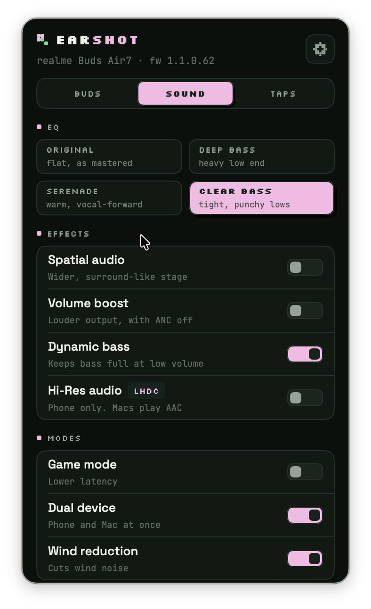

<p align="center">
  
</p>

# Earshot

A menu-bar app that gives **realme Buds** on macOS what the realme Link app gives them on a phone: battery, noise control, EQ, effects and tap controls.

realme ships no Mac app, so on a Mac the buds are plain Bluetooth headphones. Earshot talks to them the way realme Link does, over their own control channel, without needing the phone.

Built and tested on a **realme Buds Air 7** (firmware 1.1.0.62) on macOS 26, Apple Silicon.

## Features

**Buds**
- Live battery for each bud and the case, with charging and low-battery state
- Whether each bud is in your ear, out, or in the case
- Noise control: Off, Ambient, ANC
- ANC strength: Mild, Mid, Deep, or Adaptive
- Find my buds: plays a chime on the buds

**Sound**
- EQ presets: Original, Deep bass, Serenade, Clear bass
- Spatial audio, Volume boost, Dynamic bass
- Hi-Res audio (LHDC; it applies when the buds play from a phone, since Macs use AAC)
- Game mode (low latency), Dual device, Wind-noise reduction

**Taps**
- Choose what double tap, triple tap, touch & hold and single tap do on each bud
- Choose which modes touch & hold switches between

Settings are saved on the buds, so they carry over to your phone. The lowest bud's battery shows in the menu bar.

## Install

1. Download `Earshot.zip` from [Releases](../../releases) and unzip it into `/Applications`.
2. The app isn't notarized, so the first time, right-click Earshot and choose **Open**. If macOS reports it as damaged, clear the download flag:

   ```bash
   xattr -dr com.apple.quarantine /Applications/Earshot.app
   ```

3. Allow Bluetooth access when asked. Connect the buds to your Mac as usual, and Earshot links to them.

Needs macOS 15 or later.

## Build from source

Swift 6 is enough; Xcode is optional.

```bash
./scripts/build.sh            # builds dist/Earshot.app (ad-hoc signed)
./scripts/build.sh --install  # also copies it to /Applications and launches it
./scripts/test.sh             # protocol tests
```

Every rebuild has a new ad-hoc signature, so macOS asks for Bluetooth access again.

## How it works

realme, OPPO and OnePlus buds share one control protocol. It runs over classic Bluetooth RFCOMM on the vendor service `0000079A-D102-11E1-9B23-00025B00A5A5` (channel 15 on the Buds Air 7). Each message is framed as:

```
AA <length: LEB128> 00 00 <command: u16 LE> <seq> <payload length: u16 LE> <payload>
```

Replies set bit 15 of the command, and the buds also push changes unprompted. A few things specific to the Buds Air 7:

- The buds sometimes refuse noise-control changes with status `0x0E`. So far every refusal came while they reported no bud in an ear, and every successful change while they reported one. Earshot shows what the buds report instead of failing silently.
- Volume boost is read with `0x0110` and written with `0x0407`. Feature switch `0x09` is vocal enhancement, not volume boost.
- The spatial-audio reply declares a longer payload than it carries, so the frame length is trusted over the declared one.

Code layout:

| Path | What it is |
|---|---|
| `Sources/EarshotCore` | Framing, commands and reply parsing. No Bluetooth, fully tested against captured bytes. |
| `Sources/Earshot/BudsLink.swift` | Finds the buds, opens and recovers the channel (retries, wake, reconnects), one request at a time. |
| `Sources/Earshot/BudsStore.swift` | App state, with optimistic changes that roll back if the buds refuse. |
| `Sources/Earshot/UI` | The popover: Dark, Light or System theme. |

Logs:

```bash
/usr/bin/log stream --predicate 'subsystem == "xyz.srivtx.earshot"' --level debug
```

## Other realme buds

Earshot looks for paired devices named `realme Buds…`. Other recent realme models probably use the same protocol, but only the Buds Air 7 has been tested. If you try another model, open an issue with what works.

## Credits

The protocol work stands on others' captures and code:

- [Gadgetbridge](https://codeberg.org/Freeyourgadget/Gadgetbridge): the Oppo/realme framing, battery, ANC, touch and feature commands
- [BudsLink #94](https://github.com/maniacx/BudsLink/pull/94): the realme Buds Air 7 profile, EQ and spatial audio commands
- [open-real-link](https://github.com/anshwalia/open-real-link): the volume-boost commands

Earshot's code is its own Swift implementation. It isn't affiliated with realme, OPPO or OnePlus.

## License

MIT. The bundled fonts are under the SIL Open Font License.
