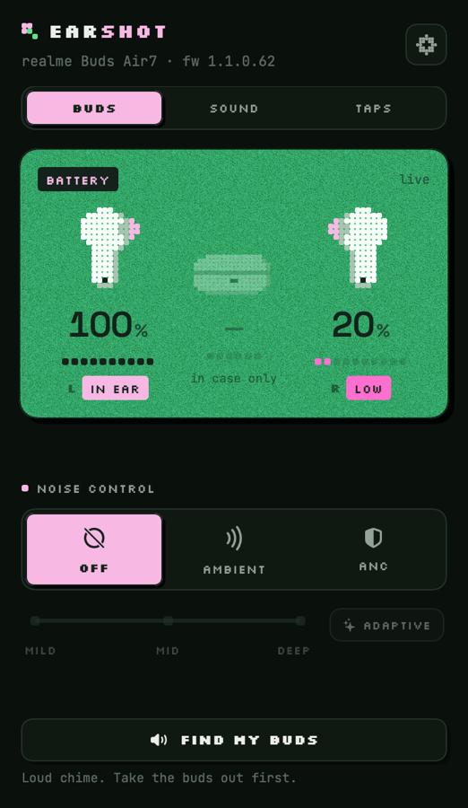
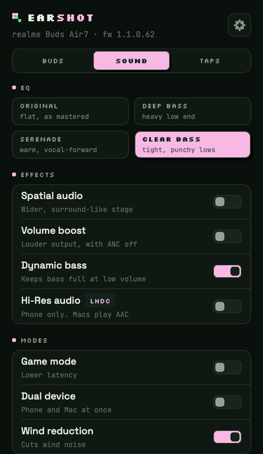
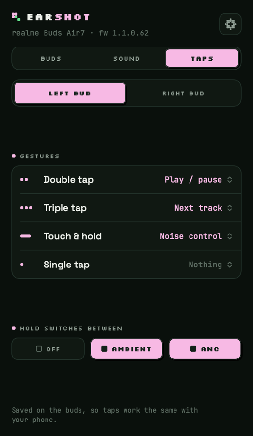
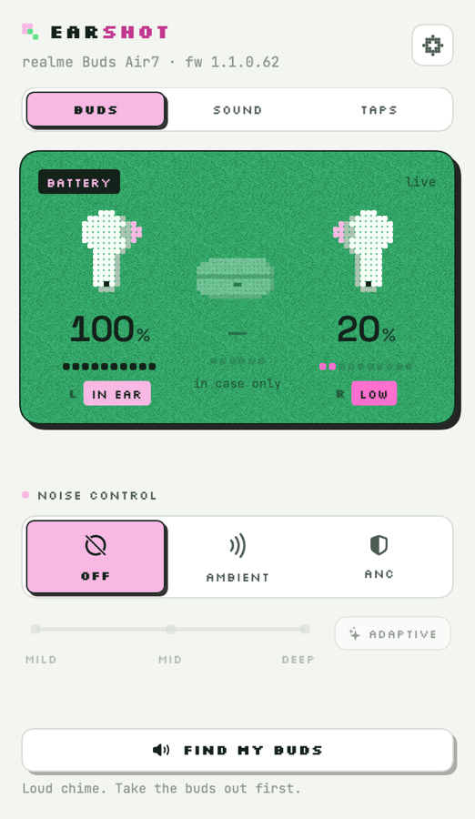
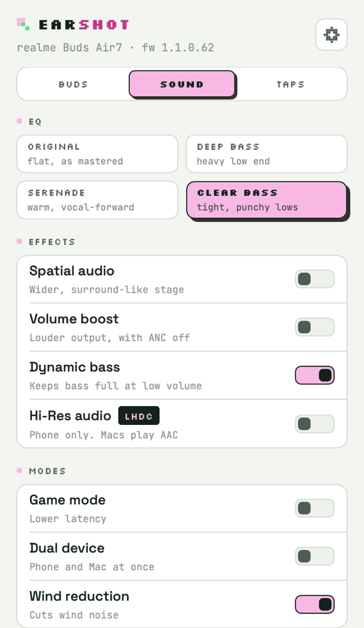
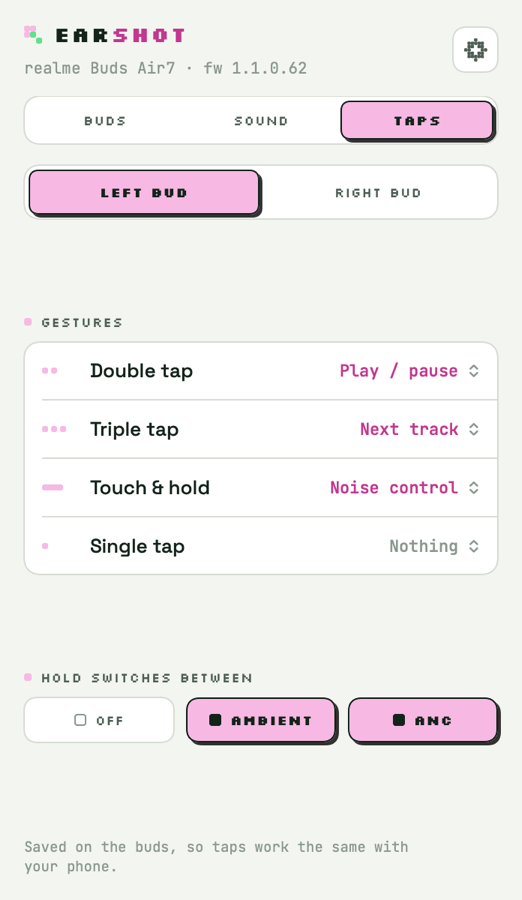

<p align="center">
  
</p>

<h1 align="center">Earshot</h1>

<p align="center">
  <a href="../../releases/latest"><b>Download for macOS</b></a> · macOS 15+ · Apple Silicon
</p>

<p align="center">
  
  
  
</p>

<p align="center"><sub>Buds · Sound · Taps, in the Dark theme. Also comes in Light, or follows your Mac.</sub></p>

A menu-bar app that gives earbuds on macOS what their phone app gives them: battery, noise control, EQ, effects and tap controls.

realme, Samsung, Sony, Nothing and the rest ship no Mac app, so on a Mac their buds are plain Bluetooth headphones. Earshot talks to them the way their own apps do, over the buds' control channel, without needing the phone. Each tab shows only what your model can do.

## Supported buds

| Brand | Models | Status |
|---|---|---|
| realme | Buds Air 7 | **Tested** (firmware 1.1.0.62, macOS 26) |
| realme, OPPO, OnePlus | Other realme Buds, OPPO Enco, OnePlus Buds and Nord Buds | Beta: same protocol as the Buds Air 7 |
| Samsung | Galaxy Buds+, Live, Pro, Buds2, Buds2 Pro, FE, Buds3, Buds3 Pro, Buds3 FE, Core, Buds4, Buds4 Pro | Beta |
| Sony | WH-1000XM and WF-1000XM series, LinkBuds, WF-C and WH-CH series, ULT Wear | Beta |
| Nothing | Ear (1), Ear (2), Ear (a), Ear (stick), CMF Buds | Beta |
| soundcore | Liberty, P and A series earbuds | Beta |

Beta models are built from published protocol work and tested against messages recorded from real buds, but not yet confirmed by an owner. Earshot shows "beta" next to their name. If you have one, see [Help test your buds](#help-test-your-buds).

## Features

What each brand gets:

| | realme / OPPO / OnePlus | Samsung | Sony | Nothing | soundcore |
|---|---|---|---|---|---|
| Battery (buds and case) | ✓ | ✓ | ✓ | ✓ | ✓ |
| In-ear state | ✓ | ✓ | | | |
| Noise control | ✓ | ✓ | ✓ | ✓ | ✓ |
| ANC strength / Adaptive | ✓ | Adaptive on Buds3 Pro and Buds4 Pro | | ✓ | ✓ |
| EQ presets | 4 | 6 | 9 | 6 on CMF Buds | |
| Effects and modes | Spatial, volume boost, dynamic bass, Hi-Res (LHDC), game mode, dual device, wind | Game mode | | Game mode, spatial, ultra bass | Wind reduction |
| Tap controls | Every gesture, each bud | Touch & hold, each bud | | Double, triple, hold, each bud | |
| Find my buds | ✓ | ✓ | | ✓ | ✓ |

On the Buds Air 7 that means:

- **Buds:** live battery for each bud and the case, whether each bud is in your ear, noise control (Off, Ambient, ANC), ANC strength (Mild, Mid, Deep or Adaptive), and Find my buds.
- **Sound:** EQ presets (Original, Deep bass, Serenade, Clear bass), Spatial audio, Volume boost, Dynamic bass, Hi-Res audio (LHDC; it applies when the buds play from a phone, since Macs use AAC), Game mode, Dual device and Wind-noise reduction.
- **Taps:** what double tap, triple tap, touch & hold and single tap do on each bud, and which modes touch & hold switches between.

Settings are saved on the buds, so they carry over to your phone. The lowest bud's battery shows in the menu bar.

**Light theme**

<p align="center">
  
  
  
</p>

## Install

1. Download `Earshot.zip` from [Releases](../../releases) and unzip it into `/Applications`.
2. The app isn't notarized, so the first time, right-click Earshot and choose **Open**. If macOS reports it as damaged, clear the download flag:

   ```bash
   xattr -dr com.apple.quarantine /Applications/Earshot.app
   ```

3. Allow Bluetooth access when asked. Connect your buds to your Mac as usual, and Earshot links to them.

Needs macOS 15 or later.

## Build from source

Swift 6 is enough; Xcode is optional.

```bash
./scripts/build.sh            # builds dist/Earshot.app (ad-hoc signed)
./scripts/build.sh --install  # also copies it to /Applications and launches it
./scripts/test.sh             # protocol tests
```

Every rebuild has a new ad-hoc signature, so macOS asks for Bluetooth access again.

The README screenshots are rendered by the app itself from live data. With the buds connected, run:

```bash
open --env EARSHOT_SHOTS="$PWD/docs/screens" /Applications/Earshot.app
```

## Help test your buds

If you own beta buds, you can confirm them in a couple of minutes:

1. Connect them and open Earshot. Try each control you see.
2. Open settings (the gear) and choose **Report → Save**. Earshot writes a text file to Downloads with the messages your buds sent and received. It holds no Bluetooth addresses.
3. [Open an issue](../../issues/new?template=buds-report.md), say what worked and what didn't, and attach the file.

That's enough to fix a wrong byte or mark a model as tested.

## How it works

Every brand runs its own control protocol over classic Bluetooth RFCOMM, on a vendor service the buds advertise:

| Brand | Service | Framing |
|---|---|---|
| realme, OPPO, OnePlus | `0000079A-D102-11E1-9B23-00025B00A5A5` | `AA`, LEB128 length, command, sequence number |
| Samsung | `2E73A4AD-332D-41FC-90E2-16BEF06523F2` (Buds2 on), serial port before | `FD … DD`, CRC-16/XMODEM |
| Sony | `956C7B26-…` or `96CC203E-…` | `3E … 3C`, escaped, byte-sum checksum, every command acknowledged |
| Nothing | `AEAC4A03-DFF5-498F-843A-34487CF133EB` | `55`, command, CRC-16/MODBUS |
| soundcore | `0CF12D31-FAC3-4553-BD80-D6832E7…` (ends in the model number) | `EE 08` out, `FF 09` in, byte-sum checksum |

Each brand has a driver in `EarshotCore` that turns Earshot's settings into its messages and its replies back into a shared model. The link opens the channel, sends one message at a time and hands the bytes to the driver.

realme, OPPO and OnePlus buds share the OPO protocol. On the Buds Air 7 it's on channel 15, and each message is framed as:

```
AA <length: LEB128> 00 00 <command: u16 LE> <seq> <payload length: u16 LE> <payload>
```

Replies set bit 15 of the command, and the buds also push changes unprompted. A few things specific to the Buds Air 7:

- The buds only accept noise-control changes while they detect a bud in an ear. Otherwise they reply with status `0x0E`, and Earshot says so (with a "wear to switch" hint beforehand) instead of failing silently.
- Volume boost is read with `0x0110` and written with `0x0407`. Feature switch `0x09` is vocal enhancement, not volume boost.
- The spatial-audio reply declares a longer payload than it carries, so the frame length is trusted over the declared one.

Code layout:

| Path | What it is |
|---|---|
| `Sources/EarshotCore` | The shared model, model detection by name, and a driver per brand. No Bluetooth, tested against captured bytes. |
| `Sources/Earshot/BudsLink.swift` | Finds supported buds, opens and recovers the channel (retries, wake, reconnects), one message at a time. |
| `Sources/Earshot/Journal.swift` | Recent traffic, for the report file. |
| `Sources/Earshot/BudsStore.swift` | App state, with optimistic changes that roll back if the buds refuse. |
| `Sources/Earshot/UI` | The popover: Dark, Light or System theme. |
| `Sources/Earshot/DevShots.swift` | Renders the README screenshots when `EARSHOT_SHOTS` is set. |

Logs:

```bash
/usr/bin/log stream --predicate 'subsystem == "xyz.srivtx.earshot"' --level debug
```

## Credits

The protocol work stands on others' captures and code:

- [Gadgetbridge](https://codeberg.org/Freeyourgadget/Gadgetbridge): the Oppo/realme framing, battery, ANC, touch and feature commands, and the Sony, Nothing and soundcore protocols with their test messages
- [GalaxyBudsClient](https://github.com/timschneeb/GalaxyBudsClient): the Galaxy Buds message layouts, and the status messages recorded from real buds that Earshot's Samsung tests use
- [BudsLink #94](https://github.com/maniacx/BudsLink/pull/94): the realme Buds Air 7 profile, EQ and spatial audio commands
- [open-real-link](https://github.com/anshwalia/open-real-link): the volume-boost commands

Earshot's code is its own Swift implementation; it uses these projects' findings about the protocols, not their code. It isn't affiliated with any of the brands it supports.

## License

MIT. The bundled fonts are under the SIL Open Font License.
